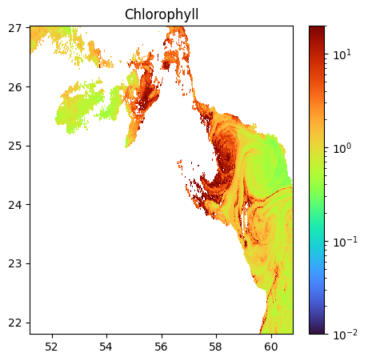
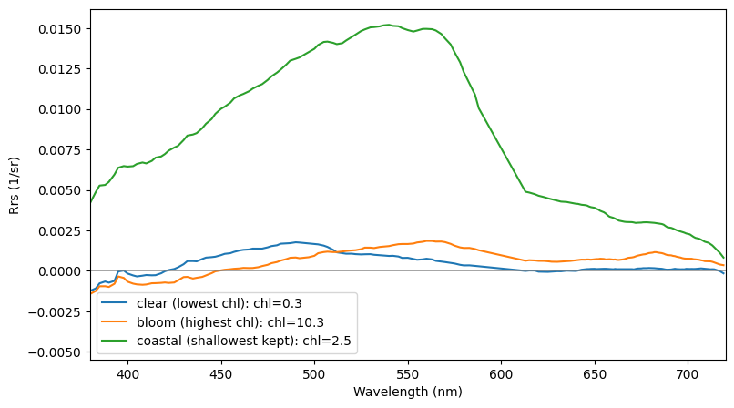
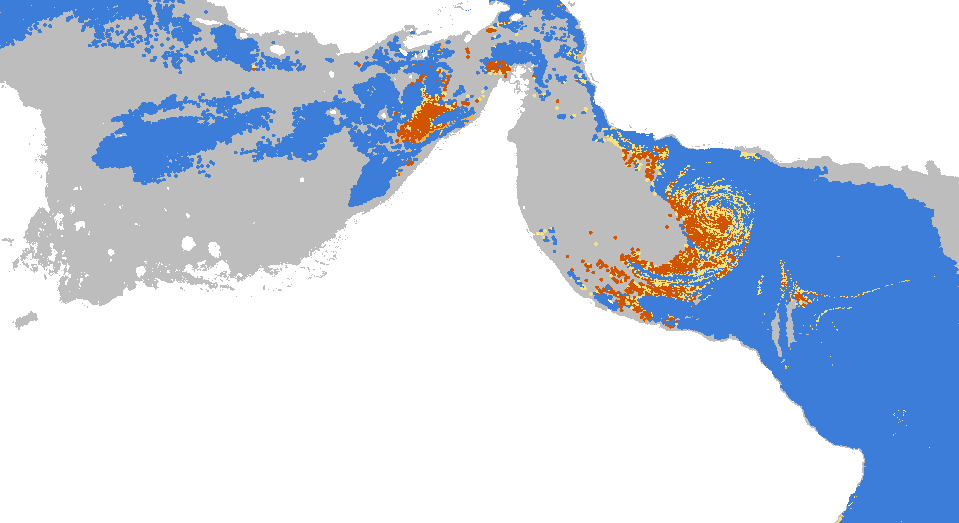
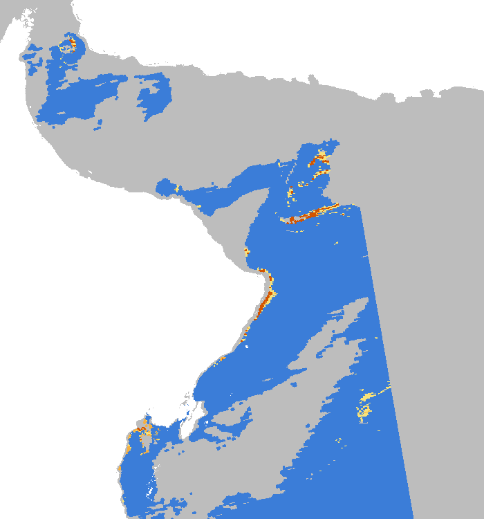

# Distinguishing dangerous algal species from harmless ones via hyperspectral imagery

Team: Fireflies 

Project: Distinguishing dangerous algal species from harmless ones via hyperspectral imagery

Submitted for: Arab Youth Space Hackathon 2026, Challenge 813

Theme: Water Quality & Inland/Coastal Water Intelligence

This proof of concept takes NASA PACE hyperspectral scenes of the Arabian Gulf and Sea of Oman and labels every dense bloom pixel as *C. polykrikoides*-like (fish-killing red tide), green *Noctiluca*-like (seasonal, non-toxic), diatom-like or unclassified, with a risk tier and a confidence score, exported to an interactive web map.  
<div align="center">
  <b>Click to Watch Demo:</b><br>
  <a href="https://youtu.be/Vyh2Mqhikxs" target="_blank"></a>
</div>

## 1. Business use case

**User:** the water quality lead at a desalination plant on the UAE east coast or in Oman. Environment agencies (EAD, MOCCAE, Oman fisheries authorities) and fish farms are secondary users.

**Decision:** when a bloom appears offshore, whether to act (sample the water, prepare pre-treatment, plan an intake shutdown) or keep watching.

**What they use today:** chlorophyll maps and field reports. Chlorophyll maps flag every dense bloom the same way, so a harmless green *Noctiluca* bloom and a *C. polykrikoides* red tide trigger the same warning. Species are confirmed only after water samples reach a lab.

## 2. The problem

- The 2008 to 2009 *C. polykrikoides* red tide in the Arabian Gulf and Sea of Oman affected about 1,200 km of coastline, killed fish and shut desalination plants for months (Richlen et al. 2010).
- 270 of 436 recorded blooms in the northern Gulf and Sea of Oman between 1980 and 2015 were *C. polykrikoides* (Mirza Esmaeili et al. 2021).
- Green *Noctiluca* blooms recur every winter in the Sea of Oman and look just as alarming on a chlorophyll map.

Satellites are the only way to watch the whole sea daily. Multispectral sensors (about 10 visible bands) can detect a bloom but sample only a few points of its spectrum. PACE OCI measures the full curve (172 bands, 346 to 719 nm, 2.5 nm steps), which is enough to compare spectral shapes and separate species.

## 3. Data used

| Dataset | Provider | Product and level | Dates | Licence |
|---|---|---|---|---|
| PACE OCI ocean colour | NASA OB.DAAC | Level-2 AOP (Rrs, nflh, l2_flags), BGC (chlor_a), IOP (bbp) | 12 passes, Oct 2024 to Mar 2026 (below) | NASA open data, free Earthdata login |
| GEBCO global bathymetry grid | GEBCO / IHO / IOC | Gridded elevation, 15 arc-second | GEBCO 2026 grid | Free to use with attribution |
| *C. polykrikoides* reference spectrum | Kim, Yoo and Son 2016, Optics Express | Field reflectance, digitised from figure | Published 2016 | Open access, cited |
| Green *Noctiluca* and diatom reference spectra | Dwivedi et al. 2015, Environ. Monit. Assess. | Field reflectance, digitised from figures | Published 2015 | Published article, cited |
| Test date documentation | NASA Earth Observatory; Copernicus Image of the Day | Imagery articles | 24 Mar 2025 | Free to use with credit |

Note: Clear water, turbid water and shallow seabed references were built from our own PACE scenes.

**PACE passes used** (timestamps UTC):

| Role | Dates |
|---|---|
| Analysis (training) | 20241030, 20241203, 20241209, 20250123, 20250406, 20251002, 20251116, 20260214, 20260314 |
| Calm (thresholds and false-alarm check) | 20241011, 20251025 |
| Held-out test | 20250324T091204 |

**Area of interest:** 51.2 to 60.79°E, 21.8 to 27.03°N. Extended test area: 56 to 63°E, 19 to 26.5°N.

## 4. Technical approach

In execution order:

1. **Screen.** Remove pixels with any of 14 Level-2 flags: ATMFAIL, LAND, HIGLINT, HILT, HISATZEN, STRAYLIGHT, CLDICE, COCCOLITH, HISOLZEN, LOWLW, NAVWARN, MAXAERITER, ATMWARN, NAVFAIL. CHLWARN and CHLFAIL are not used to exclude pixels, because dense blooms often trigger them.
2. **Regrid.** Nearest neighbour (pyresample) onto a fixed 0.01° grid (about 1.1 km), 2 km radius of influence.
3. **Depth mask.** GEBCO: water under 5 m excluded, 5 to 15 m kept but flagged.
4. **Density gate.** Weak bloom: chlor_a 5 to 10 mg/m³. Dense bloom: chlor_a of 10 mg/m³ or more AND nflh above 0.2479 W m⁻² µm⁻¹ sr⁻¹ (95th percentile of nflh in normal water, chl < 1, on the 2 calm dates).
5. **PCA.** 124 bands (430 to 699 nm), each spectrum normalised to unit length. Balanced sample (all bloom pixels plus 30,000 others per date, 359,860 pixels). 5 components keep 99.24% of the variance.
6. **Clustering.** Two-level k-means: 6 coarse clusters on raw PCs, each split into 5 on standardised PCs, giving 30 clusters. Models are frozen after training.
7. **Naming.** Each cluster's mean spectrum (dense pixels only when there are at least 50) is compared with 6 references using the spectral angle (SAM) over 500 to 700 nm, plus SAM on the Savitzky-Golay (11, 3) second derivative. Bands below 500 nm are excluded because they are over-corrected in dense blooms.
8. **Confidence.** (angle to runner-up minus angle to best) divided by the angle between those two references, clipped to 0 to 1. A species is named only if confidence is 0.25 or more and the derivative test picks the same reference. Otherwise the pixel is "unclassified dense bloom".
9. **Labels and risk tiers.**

| Code | Label | Tier |
|---|---|---|
| 0 | No data | Not assessed |
| 1 | Excluded, very shallow | Not assessed |
| 2 | Non-bloom water | None |
| 3 | Weak bloom | Monitor |
| 4 | Unclassified dense bloom | Watch |
| 5 | *C. polykrikoides*-like | High |
| 6 | Green *Noctiluca*-like | Watch |
| 7 | Diatom-like | Low |

10. **Export.** PNG overlays, 8-band GeoTIFFs, GeoJSON patches and JSON metadata for the web map.

## 5. Installation

Requires Python 3.13 (tested in Google Colab). All packages and their pinned versions are in requirements.txt.

```bash
git clone https://github.com/Fireflies-Challenge-813/HAB
cd https://github.com/Fireflies-Challenge-813/HAB
python -m venv .venv && source .venv/bin/activate
pip install -r requirements.txt
```
Input data: Full PACE scenes are too large for the repository, so they are retrieved with a script. It needs a free NASA Earthdata account (https://urs.earthdata.nasa.gov); set EARTHDATA_USERNAME and EARTHDATA_PASSWORD or log in when prompted.

```bash
pip install earthaccess
python data/download_pace.py
```
This downloads the 12 passes (exact timestamps listed in the script and in section 3) as Level-2 AOP, BGC and IOP NetCDF files into data/PACE/. The GEBCO bathymetry tiles are downloaded from https://download.gebco.net for 50.7 to 61.3°E, 21.3 to 27.5°N (main area) and 55.5 to 63.5°E, 18.5 to 27°N (test area). The digitized reference spectra are in data/sample_input/references/.

### Repository layout

```
├── README.md
├── requirements.txt
├── notebooks/space_hackathon_project.ipynb
├── data/
│   ├── download_pace.py
│   └── sample_input/references/      # digitized reference spectra (CSV)
├── results/                          # example outputs shown below
└── docs/slides.pdf
```

## 6. How to run

1. Open `notebooks/space_hackathon_project.ipynb` in Google Colab (or Jupyter).
2. In Colab, run the Drive mount cell first. Then set the data paths: `PACE_DIR` (cell 1.2), `GEBCO_PATH` (1.6), `REF_DIR` and the reference CSV paths (3.4, 3.7), and `GEBCO2_PATH` (4.1).
3. Run all cells from top to bottom. Random seeds are fixed, so results are reproducible.
4. Expected runtime: about [__] minutes in Colab once the 12 passes are downloaded.
5. At the end you get the label maps, validation printouts and `summary.json`, plus the `export/` folder and `export_for_map.zip` used by the interactive map.

## 7. Example input and output

**Input:** the 14 March 2026 pass (`PACE_OCI.20260314T084316.L2.OC_AOP`, `..._BGC` and `..._IOP`), retrieved by `data/download_pace.py`, plus the reference spectra in `data/sample_input/references/`.



*PACE OCI Level-2 chlorophyll for the example pass. The swirl off Oman is the bloom the pipeline labels.*



*Each pixel carries a full reflectance spectrum (172 bands, 346 to 719 nm). This is what the pipeline compares against the reference spectra.*

**Output:** committed in `results/`: label maps for 14 March 2026 and the 24 March 2025 test date, the PCA chart and `summary.json`.



*Each dense bloom pixel is labelled by likely species. Grey pixels were removed by quality flags (cloud, glint, viewing angle).*



*Held-out test: 1,220 dense pixels, 72.1% green Noctiluca-like, 27.9% unclassified, 0 C. polykrikoides-like.*

## 8. Results and limitations

**Results**

| Check | Result |
|---|---|
| Held-out test, 24 Mar 2025 (bloom documented as likely green *Noctiluca*) | 1,220 dense pixels: 72.1% green *Noctiluca*-like, 27.9% unclassified, 0 *C. polykrikoides*-like |
| Calm dates | 26 dense pixels in total, none called *C. polykrikoides* |
| Season and place | 99% of *Noctiluca*-like pixels fall in November to March; 78% on the Sea of Oman side |
| Synthetic mix | *C. polykrikoides* reference recognised up to about 40% dilution with clear water, then unclassified |
| Band range | Naming over 430 to 700 nm would have produced 8,803 false *C. polykrikoides* pixels; 500 to 700 nm produced none |
| Example, 14 Mar 2026 (training date) | 6,718 *Noctiluca*-like, 330 unclassified, 0 *C. polykrikoides*-like |

No pixel on any of the 12 dates was called *C. polykrikoides*.

**Limitations**

- No confirmed *C. polykrikoides* bloom has occurred in the PACE record, so true detection is untested.
- The test bloom's species is documented from imagery, not water sampled.
- Species references are digitised from published figures (Korea, northern Arabian Sea). Field and PACE spectra of clear water differ by about 13°.
- The diatom reference is 4.1° from clear water, so diatom calls are weak.
- Bands under 500 nm are excluded because of over-correction in dense blooms.
- Water under 5 m is not assessed and 5 to 15 m is flagged. 1 km pixels cannot resolve intake pipes.
- Training blooms come mostly from two late-winter 2026 events. Cloud and steep viewing angles removed some passes.
- About 1.5% of offshore moderate-chlorophyll pixels are labelled non-bloom.

## 9. Team, licence and attribution

| Member | Role |
|---|---|
| Tibyan Khaled Ahmed Bilal | Remote sensing and data science pipeline |
| MHD Manar Mallouhi | Interactive web map |

**Licence:** Code released under the MIT licence (see LICENSE).

**Attribution**
- PACE OCI data: NASA Ocean Biology Processing Group / OB.DAAC.
- GEBCO Compilation Group, GEBCO Grid.
- Kim, Yoo and Son (2016), Optics Express: *C. polykrikoides* reflectance.
- Dwivedi et al. (2015), Environmental Monitoring and Assessment: green *Noctiluca* and diatom reflectance.
- NASA Earth Observatory and Copernicus Image of the Day: documentation of the 24 March 2025 bloom.
- Richlen et al. (2010), Harmful Algae; Mirza Esmaeili et al. (2021): regional bloom history.
- Python libraries: xarray, netCDF4, pyresample, scikit-learn, SciPy, matplotlib, rasterio, earthaccess.
